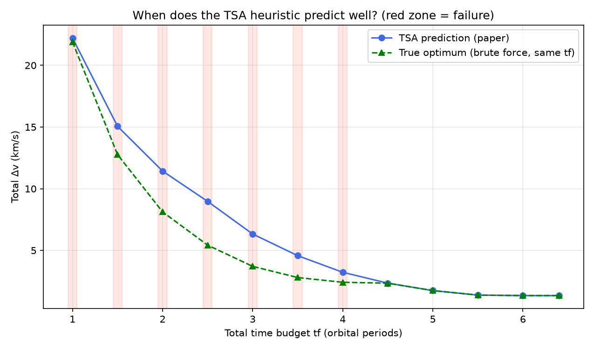
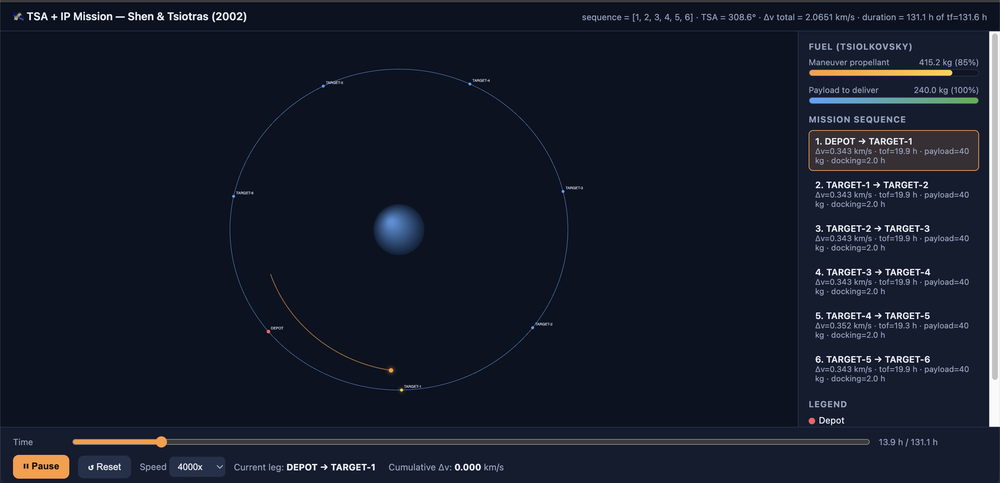

# On-Orbit Refuelling Mission Planning for Multiple GEO Satellites Using a Single Servicing Spacecraft

This project addresses the mission planning problem of a single servicing spacecraft that visits several target satellites in  circular orbits. The objective is to minimise the total `delta-v` and to study how the visiting sequence, the available mission time and the servicer's mass affect the mission.

## Model

The main entry point is `scripts/main.py`. It implements the Total Sweep Angle (TSA) model of Shen and Tsiotras (2005), specifically **Problem 2** of that paper, in which the servicer does not return to its initial position. **Problem 1**, which includes a return to the depot, is not implemented.

- The servicer departs from the `DEPOT` and visits each target exactly once.
- There is no return to the depot.
- All bodies share the same circular orbit, i.e. the same radius, inclination and right ascension of the ascending node (RAAN).
- The satellites differ only in their orbital phase.
- The mission has a total time `tf` that is shared among all legs.
- Optionally, a **fixed docking/delivery time** (`dock_time_s`, identical at every stop) is subtracted from the total `tf` *before* time is allocated among the transfer legs: `tf_transfers = tf - n_stops × dock_time_s`. This extension is not part of the original paper. It consumes no propellant, since it is not a manoeuvre; it only consumes time.
- Each leg is evaluated by solving Lambert's problem, and time is allocated through a discretised integer program (`scipy.optimize.milp`).
- The mass budget is computed with the Tsiolkovsky rocket equation, using two separate tanks (manoeuvring propellant and cargo to be delivered) and a feasibility check; see `orbital_refuel/mass_dynamics.py`.

## Simulation Assumptions

- Spherical Earth.
- Circular orbits (`e = 0`) and two-body dynamics.
- Perturbations, atmospheric drag, station-keeping manoeuvres and launch windows are not modelled.
- The Lambert solver includes multi-revolution solutions (`lambert.find_all_lambert_solutions`), validated to machine precision against `izzo2015` for M = 0, 1, 2. The cost curve of each leg (`rdvsq_planning_model.cost_curve`) uses these solutions together with a cumulative minimum over the time of flight, reproducing the "coasting" behaviour described in the paper. The resulting curve exhibits the ramp–plateau structure shown in Figs. 1 and 2 of the reference.
- The cost of a leg is the `delta-v` of the transfer. The docking time (when `dock_time_s` is used) is a fixed pause with no propellant cost.
- **Time allocation offers two modes.** `time_method="grid"` (default) discretises the cost curve on a time grid. `time_method="exact"` uses the exact β/A breakpoints (local minima of each Lambert branch, obtained through 1D optimisation) and the two time constraints of the paper (Eqs. 16b and 16c), eliminating discretisation error. It is slower but never worse.
- The mass profile assumes a fixed specific impulse `Isp`, and the Tsiolkovsky equation is applied leg by leg.
- The TSA model is specific to a single-orbit constellation; it does not directly represent constellations with different orbital radii or planes.

## Results

Running `python scripts/main.py` with the included test cases yields:

- Optimal sequence for an equally spaced constellation of 6 targets: `[1, 2, 3, 4, 5, 6]`.
- Mass profile with `m0 = 500 kg` and `Isp = 300 s`: `500.00 kg -> 248.61 kg`.
- Propellant consumed in the demonstration: `251.39 kg`.
- For `n = 5`, brute-force validation shows that TSA is not optimal for short time budgets. It matches the proven optimum from approximately `4.5` total orbital periods onwards, i.e. `0.9` periods per leg in that experiment.
- The figure for this comparison is saved to `outputs/figures/tsa_validity_regime.png`.

These values depend on the chosen parameters, the random seed and the discretisation used by the integer program.

## Installation

Requires Python 3.10 or later. In a terminal, run the following commands:

```bash
cd geo-refuel-mission-planner
python -m venv .venv
source .venv/bin/activate       # macOS/Linux
pip install --upgrade pip
pip install -e .
```

## Usage

Run experiment:

```bash
python scripts/main.py
```

During the execution the following output can be seen:

```text
=== Mission case ===

Optimal sequence: [1, 2, 3, 4, 5, 6]  (evenly spaced constellation, Isp=300.0s, m0=500.0 kg)
Leg     Δv (km/s)   mass before (kg)  mass after (kg)     propellant (kg) 
1       0.3426      500.00            445.04              54.96           
2       0.3426      445.04            396.11              48.92           
3       0.3426      396.11            352.57              43.54           
4       0.3426      352.57            313.81              38.76           
5       0.3426      313.81            279.32              34.50           
6       0.3426      279.32            248.61              30.70           

Note: Δv is the same across legs (symmetric geometry), but propellant decreases from 55.0 to 30.7 kg — exactly the pattern reportedin Tables 1 and 4 of the paper: propellant depends on the current MASS, not only on Δv.
Final service mass: 248.61 kg (used 251.39 kg out of 500.0 kg initial)


=== Regime analysis ===
======================================================================
VALIDATION 2: in which time regime is the TSA heuristic actually optimal?
               (brute-force verification)
======================================================================

tf (periods)    tf/leg      TSA predicted Δv  true optimal Δv   match?    
--------------------------------------------------------------------------
1.0             0.20        22.213            21.900            NO        
1.5             0.30        15.057            12.761            NO        
2.0             0.40        11.429            8.123             NO        
2.5             0.50        8.971             5.426             NO        
3.0             0.60        6.328             3.707             NO        
3.5             0.70        4.574             2.801             NO        
4.0             0.80        3.226             2.417             NO        
4.5             0.90        2.346             2.346             yes       
5.0             1.00        1.744             1.744             yes       
5.5             1.10        1.380             1.380             yes       
6.0             1.20        1.338             1.338             yes       
6.4             1.28        1.338             1.338             yes       

TSA starts matching the true optimum at tf ≈ 4.5 periods (~0.90 periods/leg for n=5).
The paper examples use tf=15.6 with n=4-6 (~2.6-3.9 periods/leg) — within the region where the heuristic does work.

Figure saved to: outputs/figures/tsa_validity_regime.png

=== Visualization ===
Visualization generated at: outputs/reports/mission_visualization.html
```




Run the interactive mission visualisation:

```bash
python visualization/animate_mission_html.py
```

```text
RDV Sequence: [1, 2, 3, 4, 5, 6]  Total Δv: 2.0651 km/s
Visualization saved to: outputs/reports/mission_visualization.html
```

This script generates `outputs/reports/mission_visualization.html`, a self-contained file (no external dependencies or server required) that animates the optimal sequence produced by `main.py`. The animation shows:

- the satellites moving according to Kepler's laws;
- the servicer travelling along the actual Lambert arcs from one target to the next, with targets coloured as pending, being visited or visited;
- a real docking pause at each stop (`DOCK_TIME_H`), during which a ring around the marker indicates that the servicer is docked rather than in transit;
- two live gauges, one for manoeuvring propellant and one for cargo to be delivered, computed with `mass_dynamics.simulate_mission_mass`.

The file opens directly in a web browser (double-click, or `open`/`xdg-open`/`start`).

Because all bodies in this model share the same orbit (zero inclination and RAAN for all of them), the view is purely planar; neither a second camera nor a 3D view is required.



## Project Structure

```text
geo-refuel-mission-planner/
├── README.md                         # Documentation
|__ requirements.txt                  # Requirements     
├── src/
│   └── orbital_refuel/
│       ├── keplerian.py              # Propagation of circular orbits
│       ├── lambert.py                # Lambert solver
│       ├── transfer.py               # Cost and optimisation
│       ├── mission.py                # Generation of the single-orbit constellation scenario
│       ├── rdvsq_planning_model.py   # TSA, time allocation and mass profile
│       └── mass_dynamics.py          # Explicit propellant and cargo dynamics
│   
├── scripts/                          
│   └── main.py                       # Main entry point
├── visualization/                   
│   |__ animate_mission_html.py       # Interactive visualization
└── outputs/                          # Generated figures
    └── figures/
    |    └── tsa_validity_regime.png
    |__reports/
          |__ mission_visualization.html    # Generated output
```

## References

Tsiotras, P., & de Nailly, A. (2005). Comparison between peer-to-peer and single-spacecraft refueling strategies for spacecraft in circular orbits. In *Infotech@Aerospace* (AIAA Paper 2005-7115). American Institute of Aeronautics and Astronautics. https://doi.org/10.2514/6.2005-7115